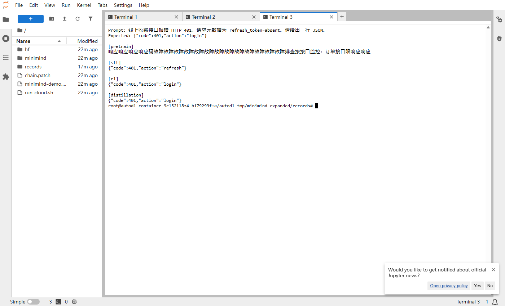

# minimind-frontend

面向前端开发者的 MiniMind 训练实验。用同一条 HTTP 401 请求对比预训练、SFT、GRPO 和白盒蒸馏。纯 CE 对照用于判断多训练一轮和加入教师信号分别带来的变化。

[中文分享稿](docs/share.md) · [English README](README_en.md) · [实跑记录](experiments/recorded/README.md)



## 实验结果

扩大实验把一个 **13.52M 参数**的学生从随机权重训练到蒸馏，用经过任务微调的 **63.91M MiniMind 教师**提供概率分布。四阶段回答使用相同问题、聊天模板和贪心解码。

| 阶段 | 观察项 | AutoDL 实测 |
| --- | --- | --- |
| 预训练 | 128 段留出文本上的续写交叉熵 | 8.778 → 2.516 |
| SFT | 322 题中的可解析 JSON 对象 | 0/322 → 307/322 |
| GRPO | 格式通过与条件动作分别检查 | JSON 319/322，策略题从 33/66 降到 29/66 |
| 蒸馏 | 教师分布距离和业务验收 | 相对纯 CE，平均 T² × KL 从 4.439 降到 1.987。策略题蒸馏 40/66，纯 CE 45/66 |

上述数据来自本项目的合成 HTTP 任务。可查看[逐题预测](experiments/recorded/expanded/records/results.json)和[蒸馏分布对照](experiments/recorded/expanded/records/teacher_kl.json)。

## 项目结构

```text
minimind-frontend/
├── model/                  MiniMind 模型与 tokenizer
├── dataset/                数据读取与标签掩码
├── trainer/                预训练、SFT、GRPO、CE 和蒸馏
├── scripts/                阶段权重串联、数据生成及推理评测
├── experiments/
│   ├── run.py              统一复现入口
│   ├── verify.py           无需 GPU 的数据和结果校验
│   ├── inputs.json         外部输入和 SHA-256
│   ├── requirements.txt   实验依赖
│   └── recorded/           三轮实测日志、结果、清单和截图
└── docs/
    └── share.md            完整分享稿和可执行示例
```

## 安装

正式训练使用 Linux 和支持 BF16 的 NVIDIA GPU。AutoDL 实测环境为 Python 3.12.3、PyTorch 2.8.0、CUDA 12.8。使用对应的预装镜像，或在驱动支持的环境中安装 CUDA 版 Torch。

```bash
git clone https://github.com/biuzhong/minimind-frontend.git
cd minimind-frontend

# 没有预装 CUDA 版 PyTorch 时先执行
python -m pip install torch==2.8.0 --index-url https://download.pytorch.org/whl/cu128

python -m pip install -r experiments/requirements.txt
python -c "import torch; print(torch.__version__, torch.version.cuda); print(torch.cuda.is_available(), torch.cuda.is_bf16_supported())"
```

以下检查需要 Python 3.11 以上和 Git。可以先在本地执行，无需装 PyTorch。

```bash
python experiments/verify.py
python experiments/run.py expanded --prepare-only
```

## 复现实验

| 命令 | 执行内容 |
| --- | --- |
| `python experiments/run.py smoke` | 用最小数据跑预训练、SFT、CE 和蒸馏，先确认 GPU 环境 |
| `python experiments/run.py official` | 加载官方预训练、SFT、GRPO 快照，再实训纯 CE 和白盒蒸馏组 |
| `python experiments/run.py from-scratch` | 4.98M 学生走完整训练链路，13.52M 教师也从随机权重训练 |
| `python experiments/run.py expanded` | 13.52M 学生走完整链路，加上 64M 教师微调、纯 CE、322 题生成对照与 KL 评测 |

每次运行使用独立的 Git 源码快照，默认保存到 `runs/<实验>-<时间>`。AutoDL 上可把 `--run-dir` 指到数据盘。下面给出完整主实验和中断后的续跑命令，分别在新建实验和恢复时使用。

```bash
python experiments/run.py expanded --run-dir "$HOME/minimind-runs/expanded"
python experiments/run.py expanded --run-dir "$HOME/minimind-runs/expanded" --resume
```

续跑时检查已经完成阶段的权重摘要，未完成阶段从其起点重跑。`smoke` 会重新运行整条小链路。`--prepare-only` 只创建隔离目录和源码快照，之后可用相同目录加 `--resume` 正式运行。

### 运行产物

- `run.json` 记录 Git 版本、实验名与完成状态。
- `records/lineage.json` 记录从零训练和扩大版的阶段命令、父权重和 SHA-256。
- `records/results.json` 保存逐阶段的同题生成。扩大版还保存 `summary.json`、`continuation.json` 和 `teacher_kl.json`。
- `source/out/` 保存可重新加载的权重。`records/*.log` 保存训练输出。

开场的 HTTP 401 题位于扩大实验各阶段的 `examples[274]`。可按[分享稿里的逐阶段示例](docs/share.md#stage-examples)逐段执行训练，再打印同一道题的四个回答。

### 外部输入与复现范围

官方权重与官方 SFT 的前 512 行按 [inputs.json](experiments/inputs.json) 下载并校验 SHA-256。默认缓存到 `.assets/`，也可以用 `--assets-dir` 指定共享缓存。官方权重对照约需下载 821 MB，扩大实验只需下载约 138 MB 的 64M 教师起点。小样本和烟雾测试的数据由代码生成。训练权重在本地运行目录生成，仓库保存结果、日志和合成样本。 [MiniMind 官方权重](https://huggingface.co/jingyaogong/minimind-3-pytorch/tree/edba70e) · [MiniMind 数据说明](https://huggingface.co/datasets/jingyaogong/minimind_dataset)

保留 [MiniMind 上游](https://github.com/jingyaogong/minimind) 的代码与 Git 历史，基线为 `3d85c71e5cd86b8622107eb1f5745bdb4cc5590a`。复跑可核对同题输出、通过数和环境日志。硬件、算子及训练环境变化可能造成数字差异。

## 许可

项目代码沿用 [Apache-2.0](LICENSE)。下载的模型和数据依其原发布协议使用。 [上游原版 README](https://github.com/jingyaogong/minimind/blob/3d85c71e5cd86b8622107eb1f5745bdb4cc5590a/README.md)
