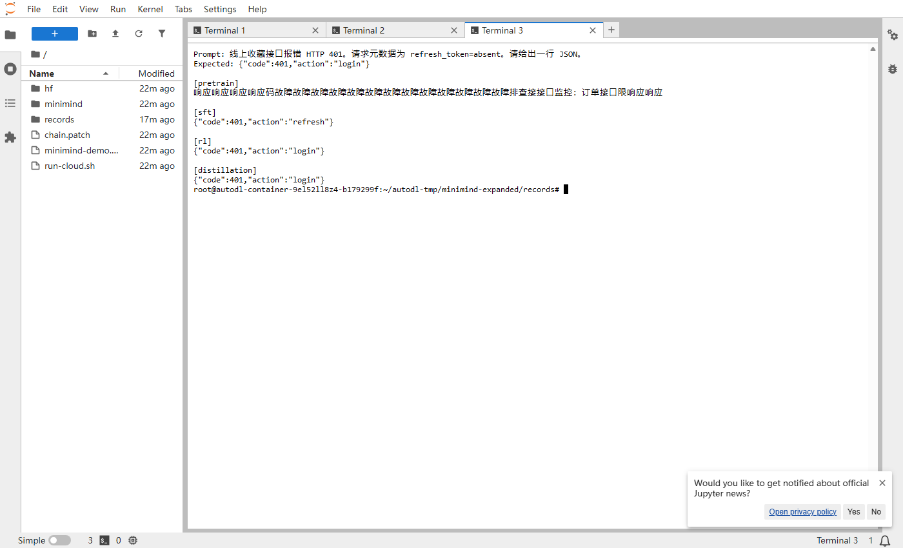
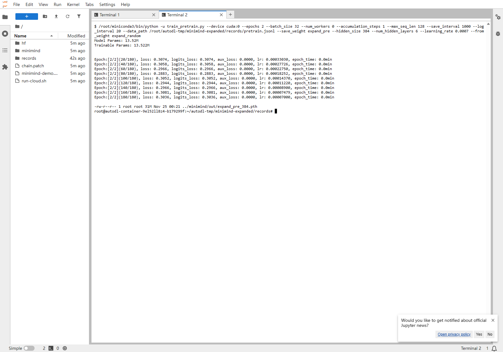
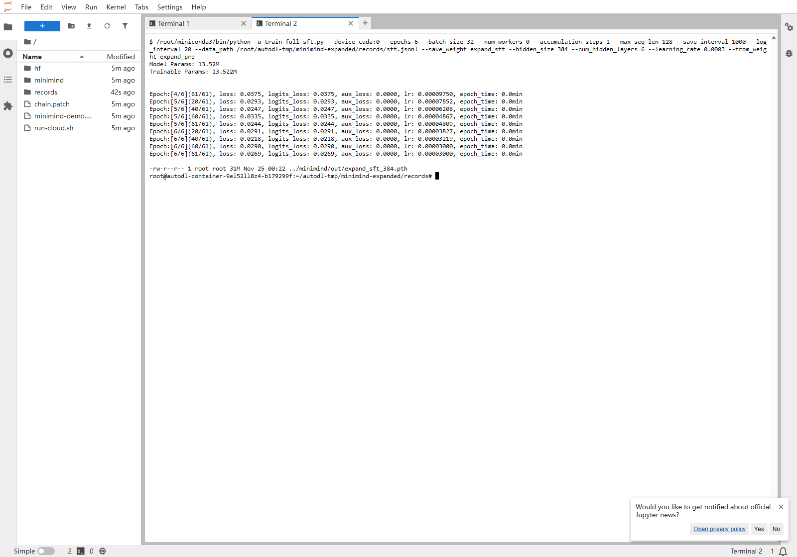
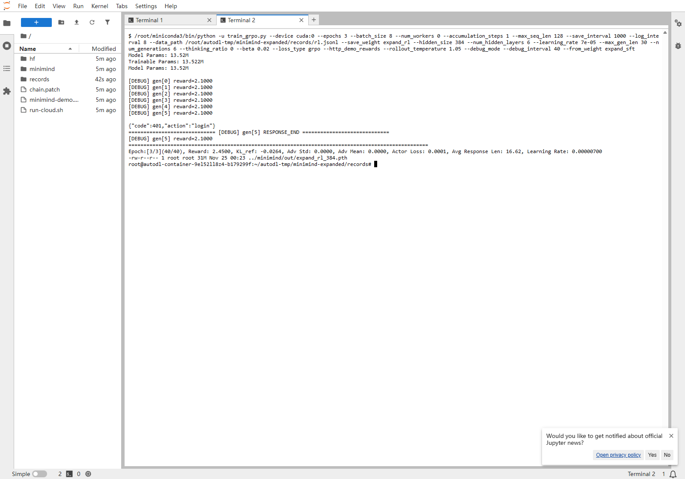
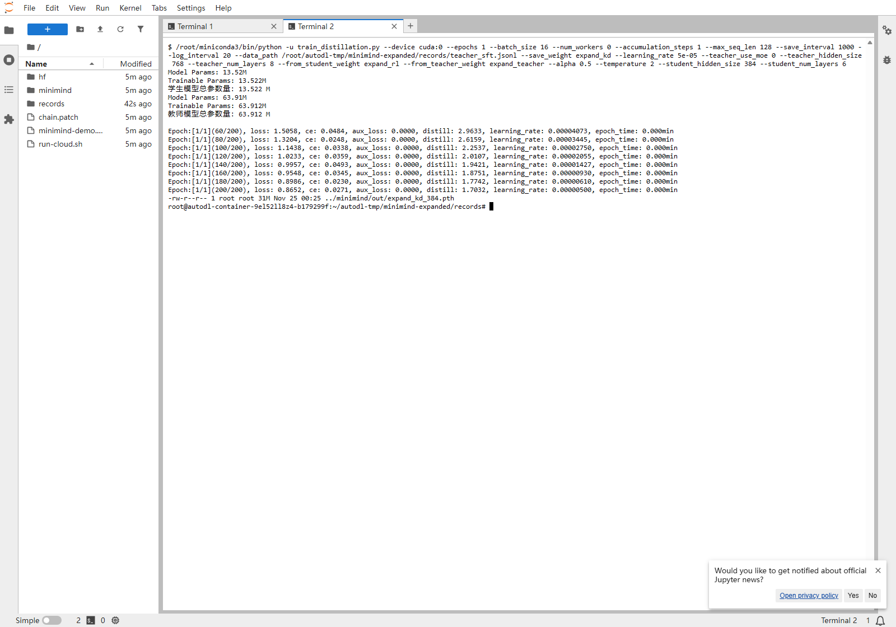
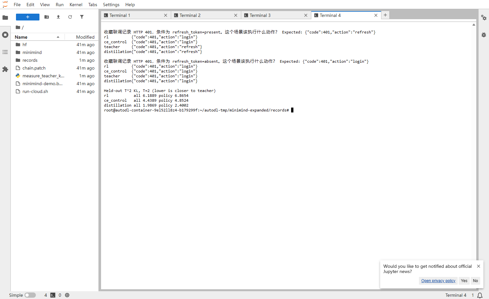
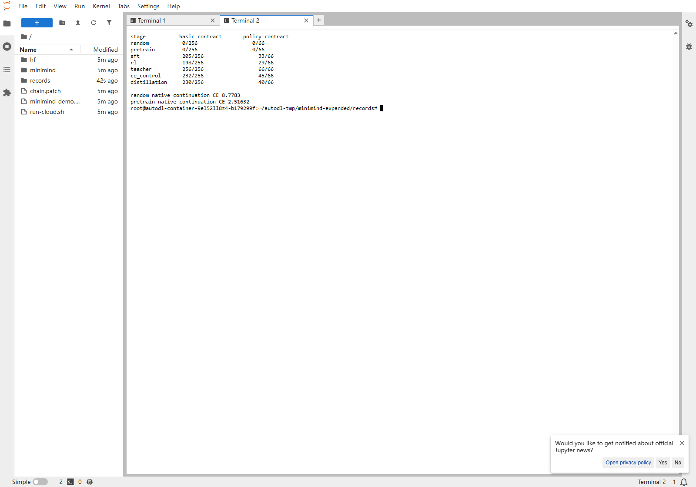
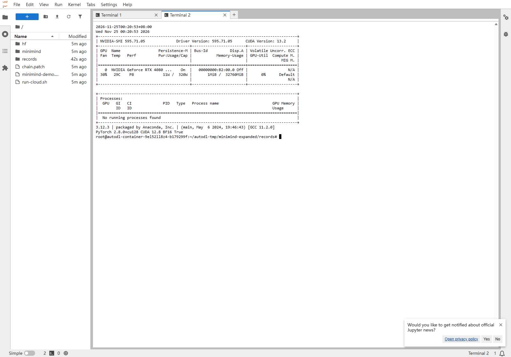

# MiniMind 模型训练与蒸馏组内分享

给前端开发者的 35 分钟实跑分享

用一次 HTTP 接口联调讲清模型训练。我们把同一个 MiniMind 学生从随机权重训练到预训练、SFT、强化学习和蒸馏。现场先给四份权重发同一条请求，检查它们能否像接口一样返回约定的 JSON，再看训练数据、代码和云端日志。

| 时间 | 分享安排 |
| --- | --- |
| 5 分钟 | 用一题讲四阶段，再看不同场景的实测对照 |
| 16 分钟 | 四个阶段各看一段代码、一张截图和一项效果指标 |
| 6 分钟 | 比较更大教师、RL 学生与纯 CE 对照 |
| 4 分钟 | 看 AutoDL 运行记录及如何复跑 |
| 4 分钟 | 用女娲 Skill 演示另一种「蒸馏」 |

## 同一道题的四阶段真实回答

> 线上收藏接口报错 HTTP 401。请求元数据为 refresh_token=absent。请给出一行 JSON。

**参考答案**　`{"code":401,"action":"login"}`。按本次实验规则，无刷新凭证时引导重新登录。以下四条使用同一题面、同一聊天模板和贪心解码，文字来自已保存的实测记录。

### 预训练后

```text
响应响应响应响应码故障故障故障故障故障故障故障故障故障故障故障故障故障排查接接口监控：订单接口限响应响应
```

**可见变化**　模型已经接触过接口排障词汇。这条回答仍是重复片段，前端无法直接解析。

### SFT 后

```json
{"code":401,"action":"refresh"}
```

**可见变化**　这一行能被 `JSON.parse` 解析，字段和状态码都正确。动作仍填成 `refresh`，违反了无刷新凭证时重新登录的规则。

### RL 后

```json
{"code":401,"action":"login"}
```

**可见变化**　动作从 `refresh` 改为 `login`，这道题通过接口验收。

### 蒸馏后

```json
{"code":401,"action":"login"}
```

**可见变化**　这道题保留了正确的 JSON 和 `login`。正文后面还有一题，能看到蒸馏后实际改对了哪一步。

投屏时可以先让大家做两次判断。第一项是这行能不能解析，第二项是解析后能不能交给业务逻辑。此题来自 322 道固定留出题，逐题原始结果在 [results.json](../experiments/recorded/expanded/records/results.json)。



想看教师究竟改变了学生的哪种行为，可跳到[蒸馏的单独对照](#distillation-effect)。

## 概念速查与训练路线

第一次听到这些词，可以先用开场的 HTTP 401 题理解它们。前四项是训练阶段，纯 CE 是用来比较蒸馏效果的一组实验。

| 概念 | 前端同事可以这样理解 | 放到 401 题里 |
| --- | --- | --- |
| **预训练**（Pretraining） | 先读大量文本，反复练习预测下一个 token，积累语言和领域信息。 | 从排障手册学习「HTTP 401」「身份认证」这些词通常怎么连在一起。 |
| **SFT**（Supervised Fine-Tuning，监督微调） | 给模型看一组「请求 → 参考响应」。模型按示例练习怎样回答，类似对照接口文档里的请求和响应样例。 | 看到问题后，学会输出含 `code` 和 `action` 的一行 JSON。 |
| **RL**（Reinforcement Learning，强化学习） | 先让模型自己生成候选，再按规则打分。模型更新以后，更倾向于生成评分高的回答。本次用的是 GRPO。 | 同一题可以给「格式正确」和「动作正确」分别打分。无刷新凭证时，`login` 是本实验约定的动作。 |
| **知识蒸馏**（Knowledge Distillation） | 用教师模型的输出指导学生训练。本次用白盒蒸馏，学生会看到教师对整个词表的预测概率。 | 学生既看到标准答案，还能学习教师在这个条件下给 `login`、`refresh` 等续写分配的概率。 |
| **纯 CE 对照** | CE 是交叉熵（Cross-Entropy）。模型给正确 token 的概率越高，该位置的 CE 越低。纯 CE 组让学生按标准答案继续训练。 | 与蒸馏组从同一份 RL 权重起步，用同一批样本、相同学习率和轮数。纯 CE 组只看参考答案，蒸馏组还学教师分布。 |

**为什么保留纯 CE 组？** 两组学生都多训练了一轮。用同一套留出题比较这两组，就能看出加上教师信号后带来的差异。可以类比对同一个前端版本跑两套配置，每次只改一个变量。 [蒸馏的单独对照](#distillation-effect)

### 学生权重如何衔接


```text
同一个 13.52M 学生
随机权重 → 预训练 → SFT → GRPO ─┬─→ 继续监督训练（纯 CE 对照）
                               └─→ 白盒蒸馏
                                      ↑
                   官方 MiniMind 63.91M 权重 → 本轮教师 SFT
```

主实验的学生宽度为 384，共 6 层。它先保存随机权重，再依次加载上一步的权重继续训练。最后两组共用同一份 RL 学生、同一批数据和同样的训练轮数。教师来自官方 MiniMind dense 权重，并在这次任务上继续微调。每个文件的父权重、命令和校验值都写在记录中。[权重血缘和训练命令](../experiments/recorded/expanded/records/lineage.json) · [权重 SHA-256](../experiments/recorded/expanded/records/SHA256SUMS)

| 术语 | 前端怎么理解 |
| --- | --- |
| 训练和推理 | 训练更新权重。推理加载一份固定权重，给它输入并读取输出。 |
| Token 与 tokenizer | Token 是字、词的一部分、数字或符号。Tokenizer 负责在文字与数字 ID 之间转换。 |
| Logits 与 softmax | Logits 是模型给每个候选 token 的原始分数。Softmax 把分数变成概率。 |
| Batch、step、epoch | Batch 是一批训练样本。Step 是处理一批的计数。Epoch 是看完一轮数据。本轮两组蒸馏对照每批都更新一次。 |
| 权重与 checkpoint | 权重文件保存模型学到的数字。训练 checkpoint 还可保存步数、优化器等状态，像能恢复的构建现场。 |
| Loss 与 reward | Loss 衡量预测与训练目标的距离。Reward 给模型生成的候选打分。评估阶段用固定留出题，类似用同一组测试用例比较多个版本。 |

**比较口径**　保留两种检查。128 段留出文本专门看续写，检查模型给参考 token 分配的概率。另有 322 道固定聊天题，同一模板、同一题面、同一贪心解码，检查能否解析成 JSON 对象，以及状态码、动作和输出结构是否全部合约。

## 预训练看能否续写

5,760 条合成排障手册用于训练，128 段带新路由的文本用来检查续写。在这批留出文本上统一重新计算 CE，便于比较续写能力。随机模型和预训练模型使用相同纯文本前缀。实测续写 CE 从 **8.7783 降到 2.5163**。

同一个前缀为「联调手册：收藏接口提示操作成功，HTTP 状态码是 」。参考续写为「200，前端动作是 ok。」。

**随机模型实际续写**

```text
新鲜新鲜新鲜新鲜新鲜新鲜新鲜新鲜新鲜新鲜新鲜新鲜导导导导导导导导导导
```

**预训练模型实际续写**

```text
状态码是 200，前端动作是 ok。
```



### 代码 把正文的下一 token 当作答案

```python
# dataset/lm_dataset.py 与 model/model_minimind.py 的等价节选
labels = input_ids.clone()
labels[input_ids == pad_token_id] = -100
predictions = logits[:, :-1, :]
targets = labels[:, 1:]
loss = F.cross_entropy(
    predictions.reshape(-1, predictions.size(-1)),
    targets.reshape(-1),
    ignore_index=-100,
)
```

可以把移位理解为把期望值提前一格对齐。第 t 格用已经读过的内容预测第 t+1 格。填充位置用 `-100` 标记，交叉熵跳过这些位置。

这里的输入文件是 [pretrain.jsonl](../experiments/recorded/expanded/records/pretrain.jsonl)。JSONL 每行一个独立 JSON 对象，预训练读取其中的 `text`。截图展示本次命令、训练损失和最终权重。注意区分训练日志里的损失和上面用留出文本重新计算的 CE。[预训练原始日志](../experiments/recorded/expanded/records/pretrain.log)

## SFT 看接口是否能消费

1,952 条指令对话把题目和参考 JSON 成对提供。现场可把模型当成接口，用 `JSON.parse` 看格式，再检验 code 和 action 值。格式正确和业务正确各记一列。四份聊天权重使用同一个聊天模板和题面。



### 代码 只给助手回答打分

```python
# dataset/lm_dataset.py 中 SFTDataset 的逻辑缩写
labels = [-100] * len(input_ids)
labels[assistant_start:assistant_end] = input_ids[assistant_start:assistant_end]

# trainer/train_full_sft.py 使用同一个模型入口
result = model(input_ids, labels=labels)
loss = result.loss
```

上游依据聊天模板定位每段助手回答，并保留其结束标记。这里把扫描角色的循环压成切片来讲。用户请求参与上下文，等模型预测助手回答时才计分。

**数据示例**　每条 SFT 数据是用户请求和参考助手响应组成的对话。下面缩写一条格式，方便对照代码。

```json
{"conversations":[{"role":"user","content":"接口返回 HTTP 401，请给出一行 JSON。"},{"role":"assistant","content":"{\"code\":401,\"action\":\"login\"}"}]}
```

[实际 SFT 数据](../experiments/recorded/expanded/records/sft.jsonl) · [SFT 原始日志](../experiments/recorded/expanded/records/sft.log)

## RL 看条件改变时动作会不会变

RL 是强化学习，MiniMind 里这次用的是 GRPO（组相对策略优化）。它在 320 条策略训练题上每题采样 6 个候选，再按规则打分。生成候选的过程也叫 rollout。实验中 401 有刷新凭证应选 refresh，没有应选 login。503 的 GET 可以重试，按实验规则非幂等 POST 停止自动重试。用 32 对只改变一个条件的测试题同时检查两边是否答对，可以发现一律选默认动作的模型。

| 权重 | 401 有刷新凭证时的回答 | 503 POST 时的回答 | 条件对同时答对 |
| --- | --- | --- | ---: |
| 预训练 | 响应响应码故障故障故障故障故障故障故障故障故障故障故障故障故障故障故障故障故障故障故障排响应响应响应响应响应响应响应响应响应 | 响应响应响应码故障响应码为接响应码为接响应码为接响应码为 40故障故障故障故障故障故障故障故障故障故障故障 | 0/32 |
| SFT | {"code":401,"action":"refresh"} | {"code":503,"action":"retry"} | 7/32 |
| GRPO | {"code":401,"action":"login"} | {"code":503,"action":"retry"} | 0/32 |
| 纯 CE 对照 | {"code":401,"action":"login"} | {"code":503,"action":"stop"} | 12/32 |
| 白盒蒸馏 | {"code":401,"action":"login"} | {"code":503,"action":"retry"} | 8/32 |
| 64M 教师 | {"code":401,"action":"refresh"} | {"code":503,"action":"stop"} | 32/32 |



### 代码 先生成候选 再按奖励调整

```python
# trainer/train_grpo.py 的 HTTP 规则奖励分支，展示一组候选
group_rewards = torch.tensor([
    score_answer(answer, expected_json) for answer in sampled_answers
])
advantage = (group_rewards - group_rewards.mean()) / (
    group_rewards.std(unbiased=False) + 1e-4
)
```

`score_answer` 在 `trainer/http_demo_reward.py`，根据能否解析 JSON、状态码、动作和输出结构分别给分。GRPO 用优势调节各候选的更新方向。同组候选分数一样时，优势就是零。本轮平均奖励从 **2.4674** 升到 **2.4935**，策略题完整通过从 **33** 降到 **29**，可以用这组数据说明部分得分与业务验收有差别。

本轮 RL 的可解析 JSON 对象从 **307 增到 319**。因此现场可以分别问「格式有没有学好」和「条件分支有没有选对」。[真实采样和奖励日志](../experiments/recorded/expanded/records/rl.log)

## 蒸馏先测教师 再比较两组学生

64M dense 教师从官方 MiniMind SFT 权重开始，用 3,200 条任务样本继续微调。预评估时它在策略题通过 **66/66**，RL 学生为 **29/66**。教师和学生共享 tokenizer，概率表中相同位置对应同一个 token，可直接做白盒蒸馏。

两组学生从同一份 RL 权重开始，使用相同数据与学习率。纯 CE 只看标准答案，白盒蒸馏再读取教师概率。KL 衡量两组概率分布的差异，蒸馏温度 T 是 2。蒸馏后学生参数量与原学生一致。



更大的备选是同词表的 MiniMind 198M MoE，可继续做白盒。Qwen3-0.6B 或 1.7B 的词表不同，可让教师生成经过规则验证的 JSON，再把这些文本拿来训练 MiniMind，这属于黑盒蒸馏。本轮扩大实验使用 64M dense 教师。[MiniMind 权重](https://huggingface.co/jingyaogong/minimind-3-pytorch/tree/main) · [Qwen3-0.6B](https://huggingface.co/Qwen/Qwen3-0.6B) · [Qwen3-1.7B](https://huggingface.co/Qwen/Qwen3-1.7B)

### 代码 冻结教师 学生同时看答案和概率

```python
# trainer/train_distillation.py 的等价节选
teacher.eval().requires_grad_(False)
with torch.no_grad():
    teacher_probs = F.softmax(teacher_logits.float() / T, dim=-1)
student_log_probs = F.log_softmax(student_logits.float() / T, dim=-1)
kl = F.kl_div(student_log_probs, teacher_probs, reduction="batchmean")
loss = alpha * ce_loss + (1 - alpha) * T**2 * kl
```

代码只在参与监督的助手 token 上做比较。纯 CE 的 alpha 为 1，模型只学习标准答案。蒸馏的 alpha 为 0.5，学生的优化目标额外包含模仿教师。学生仍使用相同的 13.52M 参数结构。 [知识蒸馏论文](https://arxiv.org/abs/1503.02531)

两组都从同一份 RL 权重继续训练一轮，这样可以估计加入教师概率的影响。与 RL 的 **29/66** 相比，白盒蒸馏提升到 **40/66**，同数据的纯 CE 达到 **45/66**。这就能分别看到继续训练带来的改善，以及在这组配置下加入教师概率后的净差异。[蒸馏日志](../experiments/recorded/expanded/records/distillation.log) · [纯 CE 日志](../experiments/recorded/expanded/records/ce_control.log) · [教师预评估](../experiments/recorded/expanded/records/teacher_gate.json)

<a id="distillation-effect"></a>

### 蒸馏的效果要单独对照

开场那题用的是 `refresh_token=absent`，RL 已经答对，适合展示行为保留。**要看蒸馏实际改变了什么，可以投屏下面这两道成对的问题。** 两句的题面相同，只切换刷新凭证是否存在。

> 收藏联调记录 HTTP 401，条件为 refresh_token=present。这个场景该执行什么动作？
>
> 收藏联调记录 HTTP 401，条件为 refresh_token=absent。这个场景该执行什么动作？

| 权重 | 有刷新凭证 present | 无刷新凭证 absent |
| --- | --- | --- |
| RL 学生 | `{"code":401,"action":"login"}` | `{"code":401,"action":"login"}` |
| 纯 CE 对照 | `{"code":401,"action":"login"}` | `{"code":401,"action":"login"}` |
| 64M 教师 | `{"code":401,"action":"refresh"}` | `{"code":401,"action":"login"}` |
| 蒸馏学生 | `{"code":401,"action":"refresh"}` | `{"code":401,"action":"login"}` |

RL 学生和纯 CE 对照在两种条件下都选 `login`。蒸馏学生在有凭证时改成 `refresh`，无凭证时保留 `login`，这对题上的动作和教师一致。部署这份学生仍只加载原来的 **13.52M 参数**，教师是 **63.91M**。



**还能测到学生的预测分布有多接近教师。** 在 AutoDL 上，用同一批 322 道留出题和同样的参考答案前缀，对 5,330 个答案 token 位置计算平均 `T² × KL(教师 || 学生)`。这里把相同位置的候选 token 概率放在一起比较，温度统一为 2，数值越小表示分布越接近教师。

| 学生权重 | 322 题的平均 T² × KL | 66 道策略题的平均 T² × KL | 策略题完整通过 |
| --- | ---: | ---: | ---: |
| RL 学生 | 6.189 | 6.865 | 29/66 |
| 纯 CE 对照 | 4.439 | 4.852 | 45/66 |
| 蒸馏学生 | 1.987 | 2.400 | 40/66 |

**现场讲两层结论。** 蒸馏的全量 KL 比纯 CE 低约 **55%**，说明它学到了更接近教师的概率分布。策略题相对 RL 修正 **11 道**；相对同数据纯 CE，修正 **4 道**、退步 **9 道**，所以最终通过数仍少 5 道。两种指标展示的是同一次实验的不同变化。 [留出 KL 原始结果](../experiments/recorded/expanded/records/teacher_kl.json) · [逐题输出](../experiments/recorded/expanded/records/results.json) · [可复跑的 KL 评估代码](../experiments/measure_teacher_kl.py)

## 同一套留出题的完整结果

基础题 256 道，策略题 66 道。完整通过要求一行合法 JSON、字段准确、状态码和动作都正确。训练与留出使用不同路由。本轮使用合成前端工单，可用于解读阶段差异。

| 权重 | 基础题 JSON | 基础题完整通过 | 策略题 JSON | 策略题完整通过 |
| --- | ---: | ---: | ---: | ---: |
| 随机初始化 | 0/256 | 0/256 | 0/66 | 0/66 |
| 预训练 | 0/256 | 0/256 | 0/66 | 0/66 |
| SFT | 241/256 | 205/256 | 66/66 | 33/66 |
| GRPO | 253/256 | 198/256 | 66/66 | 29/66 |
| 64M 教师 | 256/256 | 256/256 | 66/66 | 66/66 |
| 纯 CE 对照 | 256/256 | 232/256 | 66/66 | 45/66 |
| 白盒蒸馏 | 256/256 | 230/256 | 66/66 | 40/66 |



## 多个前端场景的四阶段实测

以下题面与四阶段输出都来自同一份 AutoDL 逐题记录。每道题在各阶段使用同一个输入。403、409 和 429 是三道独立问题，两个 503 问题只改了请求方法。预训练列展示原输出的开头，其余单元格展示完整回答。[逐题原始输出，含教师与纯 CE](../experiments/recorded/expanded/records/results.json)

| 场景与题面 | 参考答案 | 预训练 | SFT | RL | 蒸馏 |
| --- | --- | --- | --- | --- | --- | --- |
| **403 质检权限**<br>今天在质检页面排错，面板显示 HTTP 403，同时报告权限不足。请填 code 和 action。 | `{"code":403,"action":"deny"}` | `响应响应码故障…` | `{"code":403,"action":"deny"}` | `{"code":403,"action":"deny"}` | `{"code":403,"action":"deny"}` |
| **409 导出冲突**<br>今天在导出页面排错，面板显示 HTTP 409，同时报告更新条件冲突。请填 code 和 action。 | `{"code":409,"action":"conflict"}` | `响应响应码故障…` | `{"code":409,"action":"conflict"}` | `{"code":409,"action":"login"}` | `{"code":409,"action":"conflict"}` |
| **429 请求限流**<br>今天在导出页面排错，面板显示 HTTP 429，同时报告短时间重复请求太多。请填 code 和 action。 | `{"code":429,"action":"wait"}` | `响应响应码故障…` | `{"code":4,"action":"}` | `{"code":4,"action":"login"}` | `{"code":4,"action":"ok"}` |
| **503 读取失败**<br>线上导出接口报错 HTTP 503。请求元数据为 method=GET。请给出一行 JSON。 | `{"code":503,"action":"retry"}` | `响应故障故障…` | `{"code":503,"action":"retry"}` | `{"code":503,"action":"retry"}` | `{"code":503,"action":"retry"}` |
| **503 提交失败**<br>线上导出接口报错 HTTP 503。请求元数据为 method=POST。请给出一行 JSON。 | `{"code":503,"action":"stop"}` | `响应故障故障…` | `{"code":503,"action":"retry"}` | `{"code":503,"action":"retry"}` | `{"code":503,"action":"retry"}` |

403 用来展示 SFT 后能按约定交付，409 用来展示 RL 后可能丢掉原本答对的能力。409 的纯 CE 学生也答对了。503 的 GET / POST 这一对，纯 CE 学生分别答 `retry` / `stop`，蒸馏学生两次都答 `retry`。429 那题则显示，JSON 能解析以后，状态码和动作仍可能都错。

把同类题全部算进去，才能知道例子所展示的变化有多普遍。下面按原始题目的参考状态码分组，每格是完整通过数。401 和 503 只统计有额外条件的策略题，另外三列统计基础题。

| 权重 | 401 登录 | 403 权限 | 409 冲突 | 429 限流 | 503 重试 |
| --- | ---: | ---: | ---: | ---: | ---: |
| 预训练 | 0/33 | 0/32 | 0/32 | 0/32 | 0/33 |
| SFT | 17/33 | 32/32 | 19/32 | 17/32 | 16/33 |
| RL | 16/33 | 32/32 | 0/32 | 24/32 | 13/33 |
| 63.91M 教师 | 33/33 | 32/32 | 32/32 | 32/32 | 33/33 |
| 纯 CE | 20/33 | 32/32 | 32/32 | 24/32 | 25/33 |
| 蒸馏 | 24/33 | 32/32 | 32/32 | 20/32 | 16/33 |

蒸馏组在 401 上比纯 CE 多答对 4 道。在 503 条件题和 429 限流题上，纯 CE 的通过数更高。组内分享可以把 401 和 503 两组成对结果一起投屏，再用上表解释为什么一道成功案例不足以说明整体效果。

### 为 1B 教师准备的额外留出评测

新增 **6 类、24 对、48 道**题，覆盖登录续期、读写重试、素材权限、表单提交、接口限流和草稿保存。每对题只变一项当前条件，题面混入历史请求的状态码，检查模型能否抓住当前请求。仍沿用实验的 `code` / `action` 合约。

| 场景 | 一对题中改变的条件 | 期望动作 |
| --- | --- | --- |
| 登录续期 | 401 时 `refresh_token=present` / `absent` | `refresh` / `login` |
| 读写重试 | 503 时 `method=GET` / `POST` | `retry` / `stop` |
| 素材权限 | 当前返回 403 / 404 | `deny` / `missing` |
| 表单提交 | 当前返回 400 / 409 | `fix` / `conflict` |
| 接口限流 | 当前 GET 返回 429 / 503 | `wait` / `retry` |
| 草稿保存 | 当前返回 200 / 409 | `ok` / `conflict` |

在 AutoDL 上用同一批新题评估各阶段、两个教师和两路蒸馏学生。每对都答对才算成对通过，同时保留单题正确率与逐题原文。[场景评测代码](../experiments/evaluate_scenarios.py)

```bash
# 从已保存的 AutoDL 记录复算上面的分场景成绩
python experiments/evaluate_scenarios.py recorded

# 在已有扩大实验权重的 AutoDL checkout 上评测新题
cd "$HOME/minimind-runs/expanded/source"
python experiments/evaluate_scenarios.py challenge \
  --run-dir ../records \
  --output "$HOME/minimind-runs/scenarios"
```

### 1B 教师如何参与对照

MiniCPM5-1B 从公开权重出发，用已有的 3,200 条任务样本微调最后两层 Transformer 和最终归一化层。这一轮复用上一轮的 13.522M RL 权重，给三份学生相同的样本、顺序和更新次数。纯 CE 只学习标准答案，另外两组分别加 63.91M 教师和 1B 教师的答案概率。

MiniCPM5 和 MiniMind 的 tokenizer 不同。两位教师各用自己的 tokenizer，对同一组候选 JSON 文本计算分数。然后在候选答案这一层比较概率，例如让学生学习教师给 `retry` 和 `stop` 分配的相对概率。最后测试时仍让学生自由生成，再用同一套 JSON 合约打分。之前同词表的逐 token 蒸馏结果也一并保留。[1B 实验代码](../experiments/distill_1b.py) · [MiniCPM5-1B 模型说明](https://huggingface.co/openbmb/MiniCPM5-1B)

```bash
BASE="$HOME/minimind-runs"
mkdir -p "$BASE"
hf download openbmb/MiniCPM5-1B \
  --revision ac83f813ba7da263c51a9f3ec37c2072597e54af \
  --include '*.json' '*.jinja' '*.safetensors' \
  --local-dir "$BASE/teacher-1b-base"

cd "$BASE/expanded/source"
python experiments/distill_1b.py \
  --run-dir ../records \
  --teacher-dir "$BASE/teacher-1b-base" \
  --output "$BASE/1b" 2>&1 | tee "$BASE/1b.log"
```

## 三轮实验放在一起怎么讲

| 版本 | 实际执行的路线 | 留下了什么 |
| --- | --- | --- |
| 首轮官方权重演示 | 预训练、SFT、GRPO 加载官方权重做推理，另用 512 条样本训练纯 CE 和蒸馏。 | 用来走通 GPU 云端流程。四份模型在开场的单行 JSON 题上都没有通过。 [首轮实测](../experiments/recorded/README.md) |
| 小样本从零训练 | 4.98M 学生从随机权重走完四步，13.52M 自训教师参与蒸馏。 | 固定 33 题，完整通过数为预训练 0、SFT 28、RL 29、蒸馏 28。 [从零训练小样本](../experiments/recorded/small/records/results.json) |
| 本次扩大实验 | 13.52M 学生从随机权重走完四步，在同词表的 63.91M 教师上做额外 SFT 后蒸馏。 | 训练含 5,760 条预训练文本、1,952 条 SFT 对话、320 条 RL 条件题及 3,200 条教师和蒸馏用样本。主稿采用这版的 322 题和截图。 [数据与权重血缘](../experiments/recorded/expanded/records/lineage.json) |

从小样本放大以后，差异要放到对应的训练目标上读。续写 CE 下降能证明续写任务变好，JSON 解析率说明格式学习，规则题通过数用于判断奖励带来的业务行为。蒸馏用同一起点的纯 CE 组做参照，减少把「多训了一轮」误归因给教师的可能。

## AutoDL 上跑了什么

这次使用了一张 AutoDL GPU，实测 PyTorch 2.8.0、CUDA 12.8、BF16 可用。`nvidia-smi` 上的 CUDA 13.2 是驱动报告的支持版本，PyTorch 检测行显示的是本次实际运行的 CUDA 版本。BF16 是节省显存的数字表示方式。



租卡时从控制台进入实例页，选 Linux 的 CUDA 版 PyTorch 镜像。这个规模可以从单张 24 GB RTX 3090 或 4090 起步，实际显存还与批大小、序列长度和同时加载的模型有关。按量实例在控制台开机后开始计费，价格以控制台为准。训练完成并回传结果后可关机。登录用控制台提供的 SSH 指令，或打开 JupyterLab 终端。 [AutoDL 创建实例](https://www.autodl.com/docs/quick_start/) · [镜像列表](https://www.autodl.com/docs/base_config/) · [SSH 指南](https://www.autodl.com/docs/ssh/) · [计费说明](https://www.autodl.com/docs/price/)

本稿的图片均是浏览器里的 JupyterLab 终端原图。终端展示了本次训练和评估保存的实际记录。首轮蒸馏日志中的教师参数中文标签曾显示为问号，修复后用相同权重复跑，检查了每个参数张量与原权重一致。本轮扩大实验的蒸馏图已显示正常。 [原始环境日志](../experiments/recorded/expanded/records/environment.log) · [全链路日志](../experiments/recorded/expanded/records/runner.log) · [标签修复验证记录](../experiments/recorded/small/records/distillation-utf8.log)

### 一键复跑整条链路

先按 [README](../README.md#安装) 准备 CUDA 版 PyTorch。在仓库根目录执行：

```bash
python experiments/run.py expanded --run-dir "$HOME/minimind-runs/expanded"
```

脚本依次执行随机初始化、学生预训练、SFT、GRPO、教师 SFT、纯 CE、白盒蒸馏和评估。文件隔离在指定运行目录，权重在 `source/out/`。要恢复一轮训练，给同一条命令加 `--resume`。 [统一入口](../experiments/run.py)

### 扩展分支改了哪些代码

| 文件 | 分享时可指给同事看的改动 |
| --- | --- |
| `scripts/sharing_expanded.py` | 生成训练和留出数据，串联阶段权重，记录父权重和逐题评估。 |
| `trainer/http_demo_reward.py` | 把 JSON 格式、状态码和动作编码成可复查的规则奖励。 |
| `trainer/train_grpo.py` | 给 GRPO 增加 HTTP 规则奖励和采样温度选项。 |
| `trainer/train_distillation.py` | 增加纯 CE 对照路径，检查共享词表维度，用 FP32 计算分布损失。 |

项目保留 MiniMind 上游历史。 [扩大实验代码](../scripts/sharing_expanded.py) · [固定基线](https://github.com/jingyaogong/minimind/tree/3d85c71e5cd86b8622107eb1f5745bdb4cc5590a)

### 复查或投屏时用哪些文件

| 想看什么 | 文件 |
| --- | --- |
| 同题的所有原始回答 | [逐题结果 JSON](../experiments/recorded/expanded/records/results.json) |
| 随机与预训练的续写 | [续写输出与 CE](../experiments/recorded/expanded/records/continuation.json) |
| 各组得分与教师预评估 | [分组结果](../experiments/recorded/expanded/records/summary.json) · [教师预评估](../experiments/recorded/expanded/records/teacher_gate.json) |
| 训练参数、父权重和校验 | [训练血缘](../experiments/recorded/expanded/records/lineage.json) · [权重校验](../experiments/recorded/expanded/records/SHA256SUMS) |
| 可以继续推理的学生 | 复跑后在 `source/out/` 查看四阶段权重。 |

<a id="stage-examples"></a>

## 四阶段可执行示例

现场要讲原理就看各阶段的 Python 节选。要演示工程流程，可以在云端终端按顺序跑下面的命令。训练参数来自本次实跑，先建独立目录，保留首跑产物。

### 准备 独立工作目录

先跑完上面的扩大实验。以下代码复用该轮生成的数据、随机学生起点和已微调好的教师，在另一个目录逐步演示学生训练。将 BASE 改成实际运行目录，并在 Git 仓库根目录执行准备命令。

```bash
set -e -o pipefail
BASE="$HOME/minimind-runs/expanded"
PY=$(command -v python)
RUN=$(mktemp -d "$BASE/stage-demo-XXXXXX")

mkdir -p "$RUN/minimind/out" "$RUN/records"
git archive HEAD dataset model scripts trainer | tar -xf - -C "$RUN/minimind"
cp "$BASE"/records/{pretrain,sft,rl,teacher_sft,holdout}.jsonl "$RUN/records/"
cp "$BASE"/source/out/{expand_random_384,expand_teacher_768}.pth "$RUN/minimind/out/"
cd "$RUN/minimind/trainer"
```

### 1 预训练 从随机权重开始

输入是技术文本，读入保存的随机权重 `expand_random_384.pth`，输出 `expand_pre_384.pth`。

```bash
"$PY" -u train_pretrain.py \
  --device cuda:0 --epochs 2 --batch_size 32 --num_workers 0 \
  --accumulation_steps 1 --max_seq_len 128 --save_interval 1000 \
  --log_interval 20 --data_path ../../records/pretrain.jsonl \
  --save_weight expand_pre --hidden_size 384 --num_hidden_layers 6 \
  --learning_rate 0.0007 --from_weight expand_random
```

### 2 SFT 从预训练权重学习接口格式

切换到指令对话数据，读入 `expand_pre_384.pth`，输出 `expand_sft_384.pth`。

```bash
"$PY" -u train_full_sft.py \
  --device cuda:0 --epochs 6 --batch_size 32 --num_workers 0 \
  --accumulation_steps 1 --max_seq_len 128 --save_interval 1000 \
  --log_interval 20 --data_path ../../records/sft.jsonl \
  --save_weight expand_sft --hidden_size 384 --num_hidden_layers 6 \
  --learning_rate 0.0003 --from_weight expand_pre
```

### 3 RL 从 SFT 权重学习按条件选动作

对每题采样 6 条候选，使用 HTTP 规则评分。读入 `expand_sft_384.pth`，输出 `expand_rl_384.pth`。

```bash
"$PY" -u train_grpo.py \
  --device cuda:0 --epochs 3 --batch_size 8 --num_workers 0 \
  --accumulation_steps 1 --max_seq_len 128 --save_interval 1000 \
  --log_interval 8 --data_path ../../records/rl.jsonl --save_weight expand_rl \
  --hidden_size 384 --num_hidden_layers 6 --learning_rate 7e-05 \
  --max_gen_len 30 --num_generations 6 --thinking_ratio 0 --beta 0.02 \
  --loss_type grpo --http_demo_rewards --rollout_temperature 1.05 --debug_mode \
  --debug_interval 40 --from_weight expand_sft
```

### 4 蒸馏 从 RL 权重学习教师概率

从 `expand_rl_384.pth` 继续训练，加载已经微调好的 64M 教师 `expand_teacher_768.pth`。学生输出为 `expand_kd_384.pth`。

```bash
"$PY" -u train_distillation.py \
  --device cuda:0 --epochs 1 --batch_size 16 --num_workers 0 \
  --accumulation_steps 1 --max_seq_len 128 --save_interval 1000 \
  --log_interval 20 --data_path ../../records/teacher_sft.jsonl \
  --save_weight expand_kd --learning_rate 5e-05 --teacher_use_moe 0 \
  --teacher_hidden_size 768 --teacher_num_layers 8 \
  --from_student_weight expand_rl --from_teacher_weight expand_teacher \
  --alpha 0.5 --temperature 2 --student_hidden_size 384 --student_num_layers 6
```

### 用训练出的四份权重回答同一道题

执行后会重新评估同一批留出题，并打印开场的 HTTP 401 题及四条回答。

```bash
cd "$RUN/minimind"
"$PY" - "$RUN/records" <<'PYTHON'
import sys
from pathlib import Path
from scripts.sharing_from_scratch import evaluate

data = Path(sys.argv[1]) / "holdout.jsonl"
stages = [
    ("pretrain", "expand_pre", (384, 6)),
    ("sft", "expand_sft", (384, 6)),
    ("rl", "expand_rl", (384, 6)),
    ("distillation", "expand_kd", (384, 6)),
]
results = evaluate(data, stages, device="cuda:0", length=32)
example = 274
print("\n同一道题", results[0]["examples"][example]["prompt"])
for stage in results:
    print(stage["stage"], stage["examples"][example]["generated"])
PYTHON
```

## 最后四分钟 女娲 Skill

女娲项目把自己的做法叫「蒸馏任何人的思维方式」。实际可以交付的是一份根据材料提炼的人物视角 Skill，把判断规则、表达习惯、案例和来源写到 `SKILL.md` 与参考文件里。可以类比团队的前端开发规范，Agent 在回答时读取这些规则，底层模型的参数保持原样。人物视角能覆盖哪些问题，取决于材料提供了哪些证据。 [女娲 Skill](https://github.com/alchaincyf/nuwa-skill)

**现场演示**　用同一个 Agent 和同一道题，先问一次，再加载费曼视角 Skill 问一次。比较答案有没有具体例子、能否把概念讲得更清楚，以及哪些是有材料来源的内容、哪些是模型推演。

```bash
npx skills add alchaincyf/nuwa-skill -a codex
```

```text
请根据费曼公开的演讲、访谈和著作做一个视角 Skill，为提炼出的规则附上来源。
用这个视角解释浏览器缓存和 CDN 缓存的区别，举一个具体例子，再问我一个面试追问。
```

如果现场时间紧，可以直接加载项目已经提供的示例，用同一题做对比。 [费曼视角示例](https://github.com/alchaincyf/feynman-skill)
